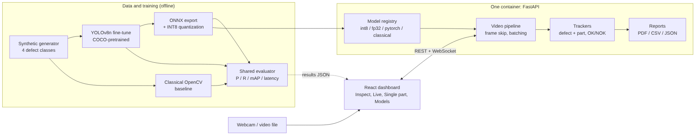
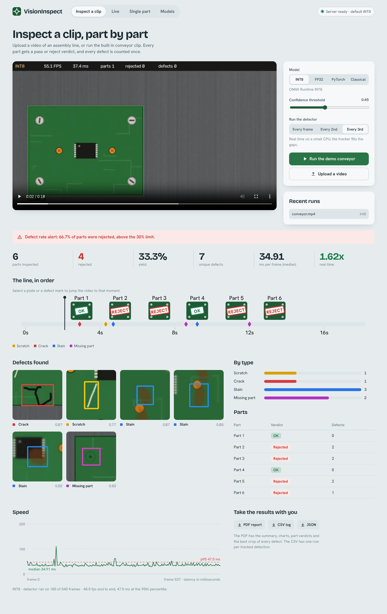
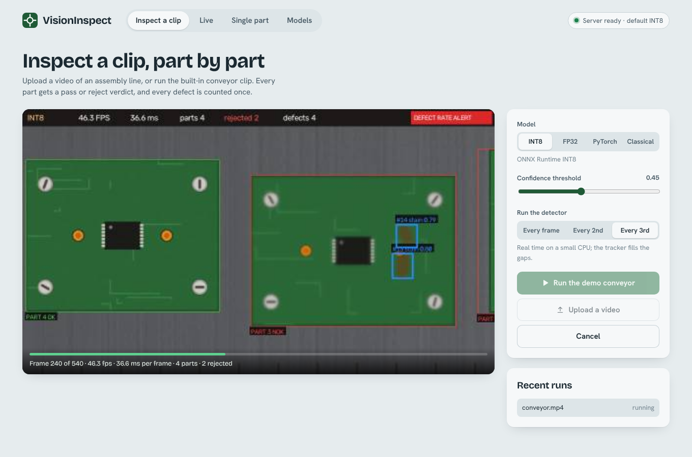
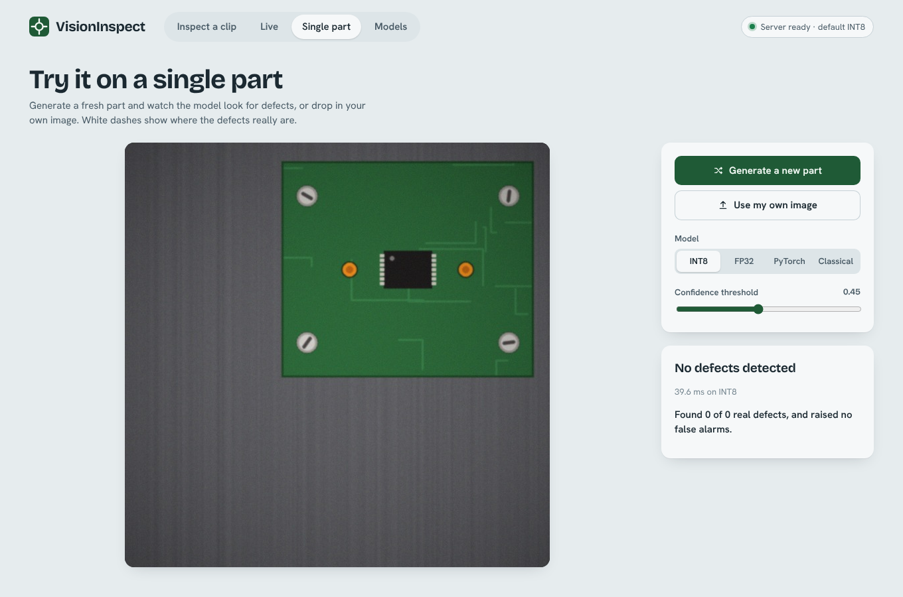

# VisionInspect: Real-Time Computer Vision Inspection System

Detect, localize and classify manufacturing defects in images and video, with a
fair comparison between a classical baseline and a fine-tuned deep detector,
an optimized (ONNX / INT8) inference path, a FastAPI service and a React dashboard.

> **Build status:** all 6 parts complete. See [`docs/PROGRESS.md`](docs/PROGRESS.md).

```
[██████████████████████████████] 6/6 parts  ·  Foundations ✅  ·  YOLO vs baseline ✅  ·  Optimized inference ✅  ·  API ✅  ·  Dashboard ✅  ·  Docker + CI ✅
```

## At a glance

| | |
|---|---|
| **Accuracy** | Fine-tuned YOLOv8n reaches **0.991 mAP@0.5** on 150 held-out images, against **0.673** for a hand-written OpenCV baseline |
| **Speed** | ONNX Runtime INT8 is **2.7x faster** than PyTorch (25.7 vs 68.6 ms/img on 2 CPU cores) and **3.4x smaller**, for -0.003 mAP |
| **Whole line** | On the demo conveyor clip: 6/6 parts counted, 100% correct OK/REJECT verdicts, 7/7 unique defects, frame mAP@0.5 0.973 |
| **Product** | Upload a video, get annotated playback, per-defect confidence, processing speed, and a PDF / CSV / JSON report |
| **Run it** | `docker compose up --build`, then open http://localhost:8000 |

### Architecture



```bash
# Fastest way to see it (needs Docker)
docker compose up --build            # dashboard + API on http://localhost:8000

# Without Docker
pip install -r requirements-runtime.txt     # serving only, no PyTorch
uvicorn api.main:app --port 8000
```

## What is in Part 1

| Piece | Where | Why it matters |
|---|---|---|
| Procedural assembly-line dataset (4 defect classes, exact boxes, YOLO format) | `visioninspect/data/synth.py` | Fully reproducible benchmark, no downloads, no leakage between splits |
| Conveyor-belt demo video with per-frame ground truth | `visioninspect/data/video.py` | Drives the live and upload demos, and lets us score video like stills |
| Detection metrics written from scratch (precision, recall, F1, AP@0.5, mAP@0.5:0.95, image-level OK/NOK) | `visioninspect/metrics.py` | Same evaluator for every model, so comparisons are apples to apples |
| Classical OpenCV baseline (colour segmentation, template check, morphology) | `visioninspect/baselines/classical.py` | The bar the deep model has to beat |
| Unit tests | `tests/` | Metrics and generator are verified |

### Defect classes

`scratch` (thin bright line) · `crack` (dark jagged line with branches) · `stain` (soft discoloured blob) · `missing_part` (a screw, capacitor or chip that should be there)

## Quick start

```bash
pip install -r requirements.txt
make data          # 600 train / 150 val / 150 test images -> data/inspect
make video         # conveyor demo clip -> data/demo/conveyor.mp4
make baseline      # evaluate the classical baseline on the test split
make test
```

## Baseline results (test split, 150 images)

| Metric | Classical baseline |
|---|---|
| mAP@0.5 | 0.673 |
| mAP@0.5:0.95 | 0.479 |
| Precision / Recall / F1 (conf ≥ 0.5) | 0.813 / 0.735 / 0.772 |
| Image-level accuracy (defective vs OK) | 0.967 |
| Latency (CPU, mean) | ~19.5 ms (~51 FPS) |

Per-class AP@0.5: scratch 0.687 · crack 0.356 · stain 0.708 · missing_part 0.941.
The baseline is strong on rigid, template-like cases (`missing_part`) and weak on
cracks, which look a lot like scratches and stains to a rule-based system. This is
exactly where a learned detector should win in Part 2.

## Part 2: pretrained YOLO vs classical baseline

COCO-pretrained **YOLOv8n** fine-tuned for 12 epochs at 512 px on CPU (about 45 minutes on 2 cores).
Both models go through the *same* evaluator on the held-out test split (150 images).
Each model's confidence threshold is tuned for F1 on `val`, never on test.

| Model | mAP@0.5 | mAP@0.5:0.95 | Precision | Recall | F1 | Image-level acc | CPU latency |
|---|---|---|---|---|---|---|---|
| Classical OpenCV | 0.673 | 0.479 | 0.813 | 0.735 | 0.772 | 0.967 | 22 ms (46 FPS) |
| **YOLOv8n (pretrained)** | **0.991** | **0.830** | **0.989** | **0.989** | **0.989** | **1.000** | 105 ms (9.6 FPS) |

Per-class AP@0.5 (classical → YOLO): scratch 0.69 → 0.97, crack 0.36 → 1.00, stain 0.71 → 1.00, missing_part 0.94 → 1.00.

**The trade-off:** YOLO is much more accurate but about 5x slower on this 2-core CPU in plain PyTorch.
Part 3 closes that gap. (The 105 ms here is a single un-batched pass; the controlled benchmark below measures PyTorch at about 57-69 ms.)

Artifacts: `outputs/compare/` (metrics table, PR curves, per-class AP, class-confusion matrices, qualitative grid)
and `outputs/yolo_training/` (loss and mAP curves). Reproduce with:

```bash
python scripts/train_yolo.py --weights models/yolov8n.pt --epochs 12 --imgsz 512 --name yolo_pretrained
python scripts/compare_models.py --split test --yolo models/yolo_pretrained.pt --imgsz 512
```

Caveats: the data is synthetic and fairly clean, so near-perfect scores are expected and will drop on real
factory images. The pretraining ablation (`--scratch`) is implemented but was not run here, to keep CPU time down.

## Part 3: inference optimization (ONNX Runtime, INT8, batching)

The trained YOLO is exported to ONNX (dynamic batch), then quantized to INT8 with ONNX Runtime static
quantization (QDQ, per-channel weights, MinMax calibration on 64 training images). All numbers are end to end
(letterbox + model + NMS) on the 150-image test split, 2 CPU threads.

| Backend | Size | mAP@0.5 | mAP@0.5:0.95 | ms/img bs=1 | ms/img bs=4 | Best throughput | Speed-up (bs=1) |
|---|---|---|---|---|---|---|---|
| PyTorch FP32 | 6.5 MB | 0.991 | 0.830 | 68.6 | 57.2 | 17.5 img/s | 1.0x |
| ONNX Runtime FP32 | 12.9 MB | 0.991 | 0.830 | 38.5 | 35.8 | 28.0 img/s | 1.8x |
| **ONNX Runtime INT8** | **3.8 MB** | 0.988 | 0.807 | **25.7** | **21.8** | **45.9 img/s** | **2.7x** |

* ONNX FP32 reproduces PyTorch accuracy exactly, which validates the custom letterbox / decode / NMS code.
* INT8 is **2.6x faster** than PyTorch at batch 4 and **3.4x smaller**, for -0.003 mAP@0.5 and -0.023 mAP@0.5:0.95.
* Batching helps a little (about 10-15%) on a 2-core CPU; it would help far more on a GPU.
* Timings on a shared 2-core VM vary by roughly +/-15% run to run. The ranking and the ratios are stable.

**Lesson learned (kept as a documented ablation):** quantizing *every* node (`--naive`) gives **mAP = 0.000**.
The YOLOv8 head's final 1x1 class predictor outputs logits with a huge dynamic range, and 8-bit activations flush the
class scores to zero. Keeping the 118 nodes of the final box/class predictors and the decode in float, while quantizing
the rest, recovers 99.7% of the accuracy and is the default recipe in `scripts/export_onnx.py`.

```bash
python scripts/export_onnx.py --weights models/yolo_pretrained.pt --imgsz 512 --calib 64
python scripts/benchmark.py --split test      # -> outputs/benchmark/{benchmark.md,benchmark.json,latency_throughput.png}
```

## Part 4: FastAPI service, tracking and reports

```bash
pip install -r requirements.txt
uvicorn api.main:app --port 8000          # interactive docs at http://localhost:8000/docs
```

| Endpoint | What it does |
|---|---|
| `POST /api/predict/image` | one image in, detections + latency + annotated JPEG out |
| `POST /api/jobs` (and `/api/jobs/demo`) | upload a clip, inspect it in the background, `frame_stride` / `conf` / model selectable |
| `GET /api/jobs/{id}` | status, progress, full summary |
| `GET /api/jobs/{id}/video` | annotated H.264 video (HTTP range supported, plays in any browser) |
| `GET /api/jobs/{id}/report.{pdf,csv,json}` | downloadable report |
| `WS /ws/jobs/{id}` | live progress + preview frames while a job runs |
| `WS /ws/live` | send webcam JPEG frames, get detections + latency back |
| `GET /api/stream/demo` | MJPEG stream of the conveyor clip inspected live |
| `GET /api/benchmarks`, `/api/models`, `/metrics` | results from Parts 2-3, backend list, Prometheus-style counters |

**What the video pipeline does** (`visioninspect/pipeline.py`):
detect (ONNX INT8) → **track defects** (SORT-style IoU tracker, so one scratch seen in 120 frames is counted once)
→ **track parts** (colour segmentation + tracker) → per-part OK / NOK verdict → yield, defect rate and an **alert** when the
rejection rate passes a threshold → annotated video with HUD (FPS, latency, counts) → JSON / CSV / **PDF report** with charts and
the best crop of every defect.

### Whole-system results on the demo conveyor clip (6 parts, 4 defective, 7 true defects)

Scored against per-frame ground truth with `scripts/eval_video.py`, INT8 model:

| Setting | Frame mAP@0.5 | Parts counted | Verdict accuracy | Unique defects (truth 7) | Speed vs real time |
|---|---|---|---|---|---|
| Close camera, detector on every frame | 0.973 | 6 / 6 | 100% | 7 | 0.58x |
| Close camera, every 2nd frame | n/a* | 6 / 6 | 100% | 7 | 0.99x |
| Close camera, every 3rd frame | n/a* | 6 / 6 | 100% | 7 | **1.23x** |
| Far camera (parts 0.62x smaller) | 0.514 | 6 / 6 | 100% | 10 | 0.54x |

\* Frame-level mAP is only meaningful when the detector runs on every frame. System-level results are unchanged by frame skipping
because the tracker carries each defect between inferences.

Things worth knowing:

* **Frame skipping plus tracking buys real time for free:** running the detector on every 3rd frame lifts throughput from 0.58x to 1.23x real time
  with identical part and defect counts. (Absolute speed depends on the host; this sandbox's CPU speed changed between sessions, so only
  compare numbers inside one row-group.)
* **Scale sensitivity is the model's real weakness.** The model trained on parts filling about 60% of the frame. In the far-camera clip they fill about
  25%, and frame-level mAP falls from 0.97 to 0.51 and the tracker over-counts defects (10 vs 7), although the part-level OK / NOK verdicts stay
  correct. That is a data-coverage problem, not a bug; the fix is multi-scale training data or a two-stage crop-then-detect design.
  The far clip ships as `data/demo/conveyor_far.mp4` so you can reproduce it.

```bash
python scripts/make_demo_video.py --out data/demo/conveyor_far.mp4 --scale 0.62 --seconds 14
python scripts/eval_video.py --video data/demo/conveyor.mp4 --model int8 --stride 3
```

## Part 5: React dashboard



A React 19 + Vite app (`frontend/`), self-hosted fonts, light and dark themes, keyboard accessible, no UI framework.

| Page | What you can do |
|---|---|
| **Inspect a clip** | Drop in a video or run the demo conveyor. Watch live preview frames and progress, then get the annotated video, a KPI ledger, a **belt timeline** (every part as a stamped OK / REJECT plate, every defect as a mark, click to seek the video), the best crop of each defect, a latency chart and PDF / CSV / JSON downloads |
| **Live** | The demo line as a live MJPEG stream, or your own webcam sent frame by frame over a WebSocket with round-trip latency |
| **Single part** | Generate a fresh part (dashed white boxes show the true defects) or drop in your own image, then see what the model finds and "found 2 of 2 real defects, no false alarms" |
| **Models** | Classical vs YOLO, per-class AP, the speed ladder (PyTorch → ONNX → INT8), batching, and the whole-line video score |

Model, confidence threshold and frame stride are adjustable on every page. The dashboard reads live results from the API,
so the Models page always reflects whatever `make compare`, `make bench` and `make eval-video` last produced.

```bash
make ui-build            # one-off: npm install + build into frontend/dist
make serve               # API + dashboard on http://localhost:8000
make ui-dev              # optional: hot-reload dev server on :5173 (proxies to :8000)
python scripts/ui_smoke.py   # headless-browser run through every page, fails on any console error
```

| Inspect (running) | Single part |
|---|---|
|  |  |

Also added to the API for the UI: `GET /api/sample/{seed}/image` and `/truth` (deterministic generated parts with ground truth),
`GET /api/jobs/{id}/frame_stats`, and the built dashboard is served at `/` so the whole thing runs as one process.

## Part 6: Docker, CI and packaging

| File | Purpose |
|---|---|
| `Dockerfile` | Three stages: Node builds the dashboard; **`runtime`** (default) is a slim Python image with ONNX Runtime only; **`full`** adds PyTorch (CPU) and Ultralytics for the PyTorch backend, training and export |
| `docker-compose.yml` | `app` on port 8000 with a healthcheck and a volume for job output; `app-full` behind the `full` profile |
| `docker/entrypoint.sh` | Regenerates the demo clip if it is missing, then starts the server |
| `requirements-runtime.txt` / `requirements-train.txt` | Serving deps (no PyTorch) vs the full dev environment |
| `.github/workflows/ci.yml` | Tests on Python 3.11 and 3.12 using only the serving deps, a dashboard build, and a Docker build followed by a `/api/health` smoke test |

```bash
make up                 # docker compose up --build
make docker-full        # image with PyTorch too
docker compose --profile full up --build app-full
```

Design notes:

* **Why a slim image.** Inference runs on ONNX Runtime, so the default image never installs PyTorch. The registry hides the
  PyTorch backend automatically when Ultralytics is not importable, so the UI only offers what the container can run.
* **One worker on purpose.** The job queue, trackers and live sessions live in process memory, so the server runs a single
  Uvicorn worker. Scale by running more containers behind a sticky load balancer, not with `--workers`.
* **Runs as a non-root user**, with job output in `/data` (a named volume).
* **Settings** are environment variables: `VI_MODELS_DIR`, `VI_IMGSZ`, `VI_JOBS_DIR`, `VI_DEMO_VIDEO`, `VI_MAX_UPLOAD_MB`, `VI_CORS`, `VI_FRONTEND_DIR`.

**What was verified, and what was not.** The sandbox this was built in has no Docker daemon, so **the image itself was never built
or run here**. Instead I checked the pieces it depends on: a clean virtualenv with only `requirements-runtime.txt` (no torch) passes all 24 tests,
and a copy of exactly the files the Dockerfile copies, started through `docker/entrypoint.sh` with the demo clip deleted, regenerated the clip, served the dashboard,
and processed the demo job end to end (6 parts, 7 defects, PDF report). The compose file and workflow parse as valid YAML. If `docker build` hits a problem on your machine,
the CI Docker job will show it first; please open an issue with the log.

## Roadmap

1. ✅ Foundations: dataset, metrics, baseline, tests
2. ✅ Train and compare a pretrained YOLO against the baseline
3. ✅ Inference optimization: ONNX Runtime, INT8 quantization, batching, latency benchmarks
4. ✅ FastAPI backend: video upload, live stream, tracking, downloadable report
5. ✅ React dashboard
6. ✅ Docker, CI, docs, polish

## Honest notes

* The dataset is synthetic. It is great for a reproducible pipeline and for
  stress-testing the system, but absolute numbers will differ on real factory data.
  The code path (YOLO-format data, metrics, serving) is identical, so swapping in a
  real dataset such as MVTec AD or NEU-DET only needs a new `data.yaml`.
* Plates are axis-aligned with small positional jitter. The baseline relies on that,
  and the deep model does not.
* Docker and the CI workflow were written and statically checked but not executed in the build environment (see Part 6).
* INT8 accuracy and latency numbers come from a 2-core CPU VM whose speed varied between sessions. Compare ratios, not absolute milliseconds.
* The webcam path was tested with synthetic frames, not a physical camera.

## Ideas for next steps

Real data (MVTec AD, NEU-DET) through the same YOLO-format pipeline; the pretraining ablation (`--scratch`); a GPU build with TensorRT or
ONNX Runtime CUDA; a rotated-box head for plates that are not axis-aligned; and a message queue so jobs survive a restart and scale past one container.
